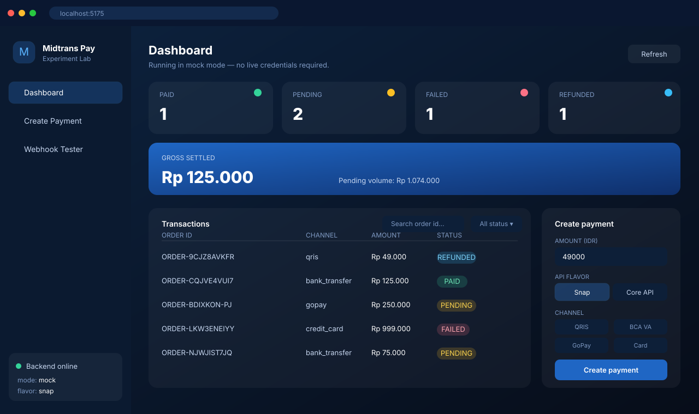
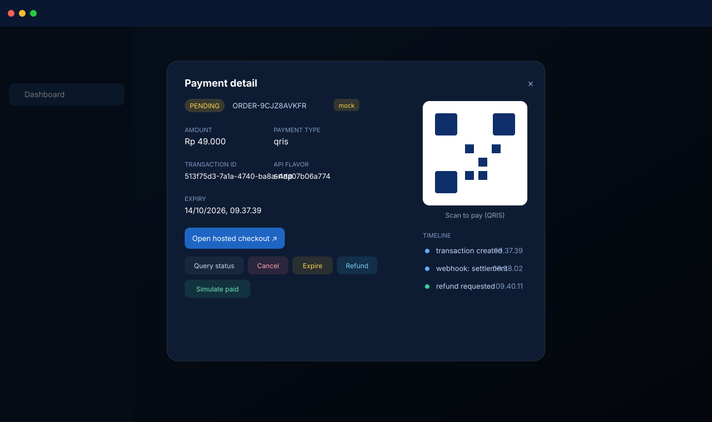
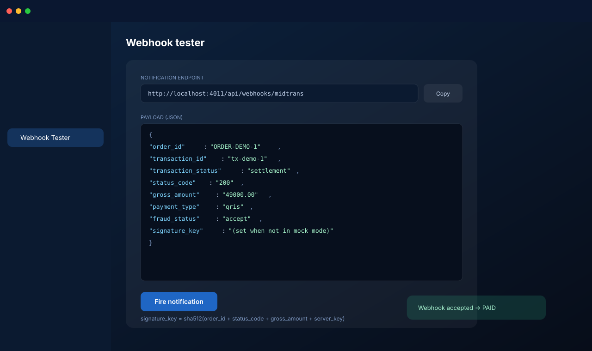
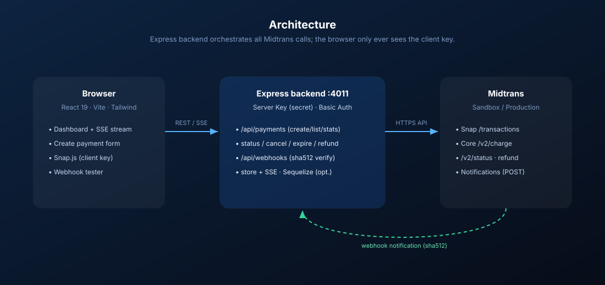

<p align="center">
  
</p>

<p align="center">
  <a href="LICENSE"></a>
  = 20">
  
  
  
  
  
  <a href="https://docs.midtrans.com/"></a>
  
</p>

> 💳 An **experimental** full-stack playground for the **Midtrans payment
> gateway** — create Snap & Core payments (QRIS, Virtual Account, GoPay,
> credit card), query / cancel / expire / refund, receive webhook
> notifications, and watch a live operator dashboard update in real time.
>
> 🧪 Ships in **mock mode** by default, so you can explore the entire payment
> lifecycle **without any credentials**.
>
> 🔓 **Public playground** — free to clone, fork and experiment with. Never
> commit real keys; `backend/.env` is gitignored, only `.env.example` ships.

---

## 📚 Table of contents

- [✨ Features](#-features)
- [🖼 Screenshots](#-screenshots)
- [🏗 Architecture](#-architecture)
- [🧰 Tech stack](#-tech-stack)
- [🚀 Quick start](#-quick-start)
- [🔁 Payment lifecycle](#-payment-lifecycle)
- [🔏 Signatures](#-signatures)
- [💾 Persistence](#-persistence)
- [📡 API reference](#-api-reference)
- [🗂 Project structure](#-project-structure)
- [🐳 Docker](#-docker)
- [🔐 Going live](#-going-live)
- [✅ Testing](#-testing)
- [🤝 Contributing](#-contributing)
- [⚠️ Disclaimer](#️-disclaimer)
- [📄 License](#-license)

---

## ✨ Features

| Area | What you get |
| --- | --- |
| **Backend** | Express.js REST API · **Snap** (`/snap/v1/transactions`) + **Core API** (`/v2/charge`) · QRIS / VA / GoPay / ShopeePay / Card · query / cancel / expire / **refund** · webhook receiver with **sha512 signature verification** · **Server-Sent Events** for live updates · zod validation · helmet + rate limiting · in-memory or **MySQL / SQLite (Sequelize)** storage |
| **Frontend** | React 19 + Vite 8 + **TailwindCSS v4** + **Tabler Icons** · dashboard with live stats · payment creator with **Snap / Core toggle** + channel picker · filterable transaction list · detail modal (QR / VA / timeline / query / cancel / expire / refund / simulate) · **webhook tester** |
| **DX** | **Mock mode** (no network) · `npm run midtrans:ping` self-test · **22 automated tests** (Vitest + Supertest) · Docker Compose · hot reload · CI workflow |

---

## 🖼 Screenshots

> Illustrative UI renders (SVG) of the running app — backend `:4011` +
> frontend `:5175`, in mock mode with seeded sample transactions.

### Dashboard — live stats, transactions & payment creator


### Payment detail — QR / VA, API flavour, timeline & experiment controls


### Webhook tester — copy the endpoint & fire sample payloads


---

## 🏗 Architecture



The **browser never sees the Server Key**. All Midtrans API calls go through the
Express backend (HTTP Basic Auth with the Server Key); the frontend only ever
holds the **Client Key** for Snap.js. Notifications flow *into* the backend,
where the `sha512` signature is verified before the transaction state updates
and is pushed to the dashboard over **Server-Sent Events**.

---

## 🧰 Tech stack

| Layer | Choice |
| --- | --- |
| Backend | Node ≥ 20 · Express 4 · zod · helmet · express-rate-limit · morgan · axios · nanoid · Sequelize (mysql2 / sqlite3) |
| Frontend | React 19 · Vite 8 · TailwindCSS v4 · Tabler Icons · oxlint |
| Tests | Vitest + Supertest |
| Infra | Docker Compose · GitHub Actions |

**Ports:** backend `4011` · frontend dev `5175` · frontend (docker) `8081` · MySQL `3306`.

---

## 🚀 Quick start

```bash
# 1. install everything + create backend/.env
npm run setup

# 2. run backend (:4011) + frontend (:5175) together
npm run dev
```

Open <http://localhost:5175>. It boots in **mock mode** — no credentials needed.

### Scripts

| Command | What it does |
| --- | --- |
| `npm run setup` | install backend + frontend deps and create `backend/.env` |
| `npm run dev` | backend + frontend concurrently |
| `npm run dev:backend` | backend only (watch) |
| `npm run dev:frontend` | frontend only |
| `npm test` | backend test suite (Vitest) |
| `npm run midtrans:ping` | connection self-test |
| `npm run seed` | seed demo transactions (backend must be running) |
| `npm run keygen` | generate an RSA keypair (future Iris / 3DS use) |
| `npm run build` | build the frontend |

---

## 🔁 Payment lifecycle

```
PENDING ──► PAID ──► REFUNDED
   ├──► FAILED  (cancel / expire / deny)
   └──► PENDING (card capture challenge)
```

In **mock mode** you can advance any transaction with the **Simulate paid**
button in the detail modal.

---

## 🔏 Signatures

- **Auth:** `Authorization: Basic base64("<SERVER_KEY>:")`
- **Notification:** `sha512(order_id + status_code + gross_amount + server_key)`

See `backend/src/utils/signature.js`.

---

## 💾 Persistence

By default the app uses a **zero-setup in-memory store**. Set `DB_ENABLED=true`
to mirror transactions into **MySQL** (or SQLite) via Sequelize — every store
change is persisted automatically once the DB is ready.

```env
DB_ENABLED=true
DB_DIALECT=mysql        # or sqlite
DB_HOST=localhost
DB_NAME=midtrans_payments
```

---

## 📡 API reference

| Method | Path | Purpose |
| --- | --- | --- |
| `GET` | `/api/health` | health probe |
| `GET` | `/api/config` | public config (client key, webhook url) |
| `POST` | `/api/payments` | create (Snap or Core) |
| `GET` | `/api/payments` | list + filter (`?status=&q=`) |
| `GET` | `/api/payments/stats` | dashboard aggregates |
| `GET` | `/api/payments/:orderId` | detail |
| `GET` | `/api/payments/:orderId/status` | live status query |
| `POST` | `/api/payments/:orderId/cancel` | cancel |
| `POST` | `/api/payments/:orderId/expire` | expire |
| `POST` | `/api/payments/:orderId/refund` | refund |
| `POST` | `/api/payments/:orderId/simulate` | mock-mode state advance |
| `POST` | `/api/webhooks/midtrans` | notification receiver |
| `GET` | `/api/payments/events` | SSE stream |

---

## 🗂 Project structure

```
midtrans-payment-experiment/
├── backend/   Express API (src/{config,controllers,db,middlewares,routes,services,store,utils,scripts})
├── frontend/  React + Vite + Tailwind (src/{components,hooks,lib})
├── docs/      API mapping + sandbox setup
├── scripts/   setup-env.mjs
└── plan.md    project plan & milestones
```

---

## 🐳 Docker

```bash
docker compose up --build
# frontend → http://localhost:8081   backend → http://localhost:4011
```

---

## 🔐 Going live

See [`docs/SANDBOX-SETUP.md`](docs/SANDBOX-SETUP.md),
[`docs/MIDTRANS-API-MAPPING.md`](docs/MIDTRANS-API-MAPPING.md) and the
[`docs/SANDBOX-LIVE-TEST.md`](docs/SANDBOX-LIVE-TEST.md) results (Snap, QRIS and
BCA VA verified against the real sandbox).

```env
MIDTRANS_MOCK_MODE=false
MIDTRANS_SERVER_KEY=SB-Mid-server-...
MIDTRANS_CLIENT_KEY=SB-Mid-client-...
```

---

## ✅ Testing

```bash
npm test        # 22 tests: signature, service (mock), store, API, DB models
```

---

## 🤝 Contributing

This repo is a **public playground** for experimenting with Midtrans — fork it,
break it, and learn from it. Good first contributions:

- add a new payment channel (e.g. `echannel` / Mandiri, `akulaku`, `cstore`)
- add Postman/Insomnia collection or a small CLI
- improve the mock-mode simulator
- add Playwright E2E tests

Before opening a PR:

```bash
npm test            # backend
npm run lint        # frontend
npm run build       # frontend build must succeed
```

**Never commit secrets.** Only `backend/.env.example` belongs in the repo;
`backend/.env` is gitignored.

---

## ⚠️ Disclaimer

Experimental, non-production sample code. Midtrans is a trademark of its
respective owner. Follow Midtrans' security guidance for production use.

## 📄 License

MIT
